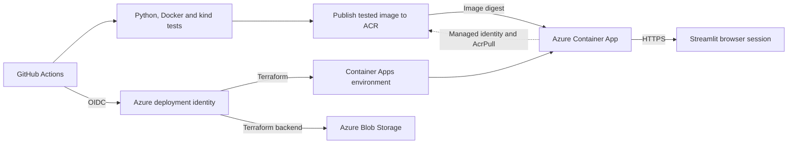

# Deploy the Research Brief Generator to Azure

The Streamlit app runs on Azure Container Apps in the Consumption workload profile. Azure Container Registry stores the exact image that passed the tests. Terraform manages Azure resources and records infrastructure state in Azure Blob Storage.



GitHub Actions runs CI on open pull requests and pushes to `main`. When Azure is configured, a successful run on `main` provisions the foundation, pushes the tested Docker image to ACR, deploys its digest, and checks the live HTTPS endpoint. A commit tag makes the image easy to find in ACR. The digest makes the deployed revision reproducible. The app scales between zero and one replica.

## Run the app and tests locally

Use Python 3.12 and Docker.

```bash
python3.12 -m venv .venv
source .venv/bin/activate
python -m pip install --require-hashes -r requirements.lock
python -m unittest discover -s tests -v

docker build -t research-brief:local .
docker run --rm -p 127.0.0.1:8501:8501 research-brief:local
```

Open [http://localhost:8501](http://localhost:8501). Run `scripts/smoke.sh http://localhost:8501` in another terminal. The app's password fields accept visitor-supplied Anthropic and Tavily keys. The smoke check covers the app shell and health endpoint. The Python tests exercise the full research loop with mocked providers.

To practice the Kubernetes deployment, install `kind` and `kubectl` and run these commands with the same local image tag.

```bash
kind create cluster --name research-brief
kind load docker-image research-brief:local --name research-brief
kubectl apply -f deploy/kubernetes/app.yaml
kubectl rollout status deployment/research-brief
kubectl port-forward service/research-brief 8502:8501
```

In a second terminal, run `scripts/smoke.sh http://localhost:8502`. When you're done, stop the port-forward and run `kind delete cluster --name research-brief`.

## Connect Azure once

Use Bash, Azure CLI, and an Azure subscription where you can register resource providers, create resource groups, and assign roles. Azure Container Registry Basic, Blob Storage, app usage, and log ingestion can incur charges.

1. Run `az login` and select the subscription with `az account set --subscription <subscription-id>`. Confirm the subscription before creating resources with `az account show --query '{name:name,id:id}'`.
2. From the repository root, run `scripts/bootstrap-azure.sh OWNER/REPO westeurope research-brief`. Replace the GitHub repository or Azure region as needed. The script creates two dedicated resource groups, a storage account with a private state container, and the GitHub workload identity. The identity trusts GitHub tokens issued for this repository's `main` branch.
3. Save the five values printed by the script under **GitHub repository → Settings → Secrets and variables → Actions → Variables**. Set `AZURE_CLIENT_ID` last to enable deployment. The values are identifiers. GitHub obtains short-lived Azure credentials using OIDC. Keep Azure sign-in tokens and provider API keys out of the repository.
4. Merge the deployment changes to `main` or select **Actions → Test and deploy to Azure → Run workflow** once the workflow is present on `main`. If Azure reports a permission error immediately after bootstrap, allow time for Azure RBAC propagation and rerun the workflow.
5. Open the app URL in the completed run's summary. Enter your provider keys and generate a brief to verify a real research run.

The GitHub identity can manage the app resource group, push images to its registry, read and write the state container, and grant or revoke the `AcrPull` role in the app resource group. The Container App uses its own managed identity to pull from ACR. Azure uses two independent Terraform state files so the registry can be created before the first app image is published.

## Inspect a deployment

Run these commands with the same Azure subscription selected.

```bash
az containerapp revision list --name research-brief --resource-group rg-research-brief --output table
az containerapp logs show --name research-brief --resource-group rg-research-brief --type system --tail 30
scripts/smoke.sh https://<container-app-hostname>
```

For an image-pull error, check the system logs, image digest, registry policy for ARM audience tokens, and `AcrPull` role assignment. For a failed health check, check the app port and startup probe. The GitHub deploy job checks that the commit is still at the head of `main` before applying Terraform.

To retire the project, disable deployment by removing the `AZURE_CLIENT_ID` GitHub variable and let any running deployment finish. Verify the subscription and contents of both dedicated resource groups. Delete the app group first, then delete the state group if you no longer need infrastructure state and its history.

## Portfolio notes

- Explain how a pull request tests the agent's feedback loop and deploys the container in a temporary Kubernetes cluster, using probes and a Service to verify it.
- Explain how GitHub OIDC authenticates the deploy job and how a separate Azure managed identity lets Container Apps pull the image.
- After you verify the Azure URL, consider this résumé bullet. “Deployed a LangGraph research agent to Azure Container Apps using Docker, Terraform, and GitHub Actions with OIDC. Added Kubernetes rollout checks in CI and verified the live HTTPS endpoint.”
